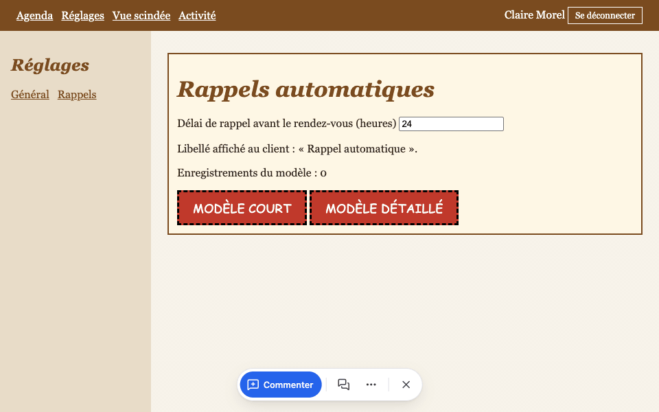
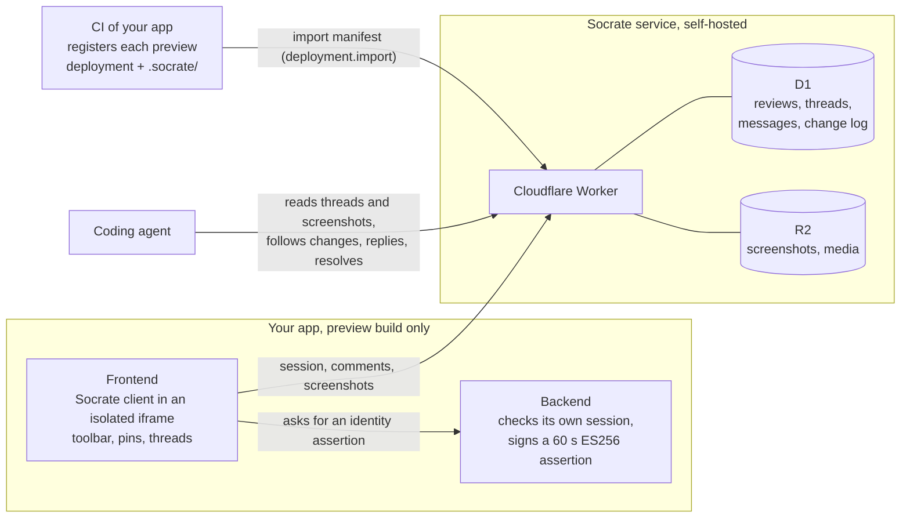
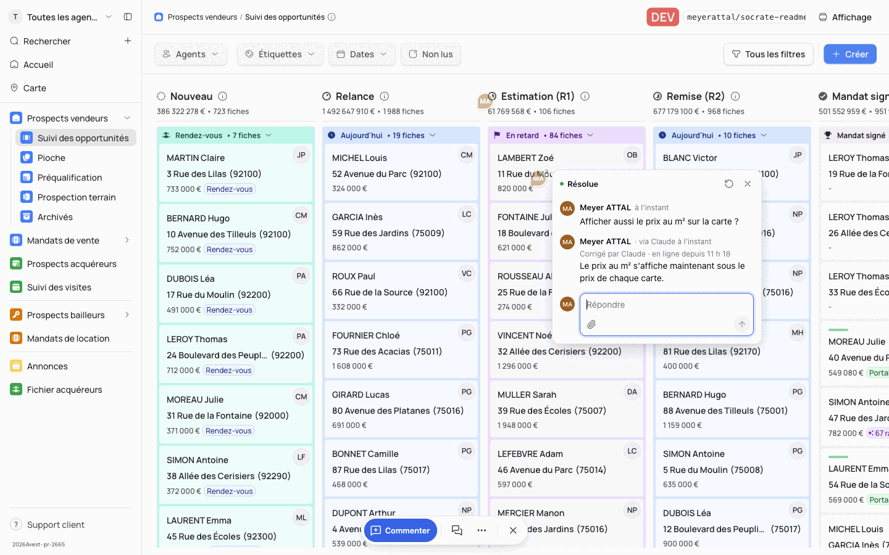

<h1 align="center">Socrate</h1>

<p align="center">
  <strong>Click any element of a pull request preview to comment.<br>Your coding agent reads the thread, fixes it and resolves it.</strong>
</p>

<p align="center">
  <sub>Built by</sub><br>
  <a href="https://www.avest.fr">
    <picture>
      <source media="(prefers-color-scheme: dark)" srcset=".github/assets/avest-logo-dark.svg">
      <source media="(prefers-color-scheme: light)" srcset=".github/assets/avest-logo-light.svg">
      
    </picture>
  </a>
</p>

<p align="center">
  <a href="https://www.npmjs.com/package/@meyer0x/socrate"></a>
  <a href="LICENSE"></a>
  <a href="CONTRIBUTING.md"></a>
</p>

<p align="center">
  <a href="docs/how-it-works.md">Docs</a> ·
  <a href="#quick-start">Quick start</a> ·
  <a href="#for-coding-agents">For coding agents</a> ·
  <a href="#self-host">Self-host</a>
</p>

<p align="center">
  
  <br><sub>Socrate on a pull request preview of the Avest CRM. Every name, address and amount on screen is fictional sample data.</sub>
</p>

Socrate lets product people leave contextual feedback directly inside the preview deployments of a web app, and lets coding agents read that feedback back, reply and resolve it.

## Why

A pull request preview is where product people actually see a change. Their feedback usually leaves that context: a screenshot in a chat, a vague ticket, a comment that no longer matches the build. The developer, or the coding agent doing the work, then has to guess which element, which screen and which version the remark was about.

We built Socrate at [Avest](https://www.avest.fr), a French real-estate CRM, to review the pull request previews of our own product and hand that feedback straight to coding agents. We opened it so that any team shipping previews can do the same.

Socrate keeps the feedback where it was given. Socrate never calls an AI model and never triggers anything on its own. Agents come and read when they decide to.

## How it works



1. Your CI imports each preview deployment into the service, with the `.socrate/` manifest that explains what changed. The manifest is required: a title, a before/now summary and at least one zone.
2. In the preview, your backend vouches for the signed-in user with a short-lived signed assertion. Socrate exchanges it for a 5-minute session. No cookie or token of your app ever reaches Socrate.
3. Reviewers comment in place. Each targeted comment carries a fresh screenshot of the tab, taken with the browser's tab-capture permission.
4. Agents read the feedback through the [agent API](docs/agent-api.md) with a read-only token, or through the `socrate` CLI once their developer has connected them.

Details: [docs/how-it-works.md](docs/how-it-works.md).

## Features

- **Comment in place.** A reviewer clicks an element in the preview and writes a comment. Socrate stores it with the target element, the route, a screenshot of the tab taken at that moment, and the exact deployment and revision. Images and videos can be attached.
- **Threads that stay on the page.** Pins on elements and a list of conversations per screen. Threads survive redeployments of the preview; when the target can no longer be found, the thread shows where it was on its screenshot.
- **Agents in the loop.** A coding agent lists open threads, reads replies and screenshots, and polls for changes incrementally with a read-only token. Connected by its developer, it also replies, resolves and reopens threads in their name, each resolution can be linked to a commit.
- **Nothing in production.** The client exists only in preview builds; `socrate check-absent` checks production builds.
- **Self-hosted.** One Cloudflare Worker, one D1 database, one R2 bucket, under your account.

## Quick start

Requirements: Node 22.18 or later, which runs TypeScript files directly (CI uses 25.9), npm, macOS or Linux. Everything stays inside the clone: npm cache, test browsers, runtime data and temporary files live under `.local/` and `.tmp/`, both ignored by Git.

```sh
git clone https://github.com/AVEST-VAP/socrate.git && cd socrate
unset NODE_OPTIONS
export TMPDIR=$PWD/.tmp/tmp TMP=$PWD/.tmp/tmp TEMP=$PWD/.tmp/tmp
export npm_config_cache=$PWD/.local/npm-cache PLAYWRIGHT_BROWSERS_PATH=$PWD/.local/pw-browsers NODE_COMPILE_CACHE=$PWD/.local/node-compile-cache
mkdir -p "$TMPDIR" "$npm_config_cache" "$PLAYWRIGHT_BROWSERS_PATH" "$NODE_COMPILE_CACHE"
npm ci
npm run demo
```

`npm run demo` runs the real Worker under Miniflare with local D1 and R2 on `http://127.0.0.1:8787`, imports the demo manifest, and serves a fictional scheduling app on `http://127.0.0.1:5173`. Open the app, sign in as one of the four fictional users, and use the toolbar at the bottom of the page. Chrome or Chromium is needed for the tab screenshot. Press Ctrl+C to stop; the launcher confirms that every resource is closed.

> [!NOTE]
> The UI is in French: « Commenter un élément » (comment on an element), « Conversations » and « Plus d’options » (more options).

- `npm run demo -- --reset` starts again from empty storage.
- `SOCRATE_SERVICE_PORT`, `SOCRATE_DEMO_PORT` and `SOCRATE_INSTANCE` change the ports and the instance name.
- `npm run parcours-local -- --reset` runs the whole stack once in the foreground: it publishes a fictional comment, reads it back with the agent token, and stops.
- `npm run serve -- --origin <your app> --manifest <.socrate folder>` runs only the service, for your own app's dev server: see [Try Socrate against your own app locally](docs/integrate.md#try-socrate-against-your-own-app-locally).

The demo data is fictional. The demo reaches no external service: the Worker's outbound traffic is refused.

## Integrate

```sh
npm install @meyer0x/socrate
```

For an app built with Vite and React 19 and deployed from GitHub Actions, the package does most of the work: a `socrate.yml` of three values, a Vite plugin, one component behind `import.meta.env.SOCRATE`, and two CI steps. You provide three pieces; [docs/integrate.md](docs/integrate.md) has a complete example and the contracts.

1. **An identity bridge in your backend.** An authenticated route checks your own session and returns a 60-second ES256 assertion naming the user, the preview origin and the requested capabilities. The private key stays in your backend.
2. **The client, in preview builds only.** Render `SocrateReview` from `@meyer0x/socrate/react` behind `import.meta.env.SOCRATE`, which the plugin sets to `false` in every build except a prepared preview build. Without React or npm, import the module served by your Socrate instance (`GET /v1/client`, then `mount(element, props)`).
3. **Two CI steps.** `npx socrate preview prepare` before the build turns Socrate on for pull requests that carry the `socrate` label; `npx socrate preview register` after the deployment registers the preview and its manifest with a `deployment.import` token. `npx socrate check-absent dist` checks production builds. Without the package, the import is a plain HTTP `PUT`. When the work is done, archive the review with a `review.archive` token.

Package reference: [packages/socrate/README.md](packages/socrate/README.md).

## For coding agents

<p align="center">
  
</p>

Connect your agent once per project and machine, then let it work through the feedback of your pull request:

```sh
# Once: approve the printed code in the preview (Plus d’options → Connecter un agent)
npx @meyer0x/socrate login
# Open threads of the current branch's pull request
npx @meyer0x/socrate threads --json
# After the fix is committed: resolve in your name, linked to HEAD
npx @meyer0x/socrate resolve <id> --message "Shortened the label."
```

`thread <id> --captures .socrate` downloads the target and the screenshot of a thread, and `reply <id> "<message>"` answers it. Messages show "Claude via Your Name"; resolutions read « Corrigé par Claude », with the commit on hover. Details: [For coding agents](packages/socrate/README.md#for-coding-agents).

- Read feedback without a person, with a `review.read` token: [docs/agent-api.md](docs/agent-api.md). The examples in that file are executed verbatim by the test suite.
- Prepare a review: the `.socrate/` manifest section of [docs/integrate.md](docs/integrate.md).
- Work on Socrate itself: [AGENTS.md](AGENTS.md) and [CONTRIBUTING.md](CONTRIBUTING.md). The repository ships a verification skill in `.agents/skills/verify-socrate/` that drives the demo like a reviewer.

## Self-host

The reference deployment is a Cloudflare Worker with one D1 database and one R2 bucket. `npm run distant` prepares the configuration, the remote migrations and the technical tokens, and prints each `wrangler` command; it never calls Cloudflare itself. Step by step: [docs/self-host-cloudflare.md](docs/self-host-cloudflare.md). Archiving, purge, backup and restore: [docs/operations.md](docs/operations.md).

## Project status

Socrate is young software. Its first user is Avest, on the pull request previews of its CRM, and it has been integrated in that one application so far. Expect breaking changes before 1.0.

- The local stack and the behaviours above are covered by automated tests (`npm run verify`). On a fresh clone, up to four browser cases fail: they are known failures, not regressions, listed in [CONTRIBUTING.md](CONTRIBUTING.md#known-failures-not-regressions), so `npm run verify` currently exits with code 1. The Cloudflare procedure has been replayed on a local D1 by `tools/local/test/distant.test.ts`; it has not been exercised against Cloudflare by this repository's tests.
- The UI, the code messages, the code comments, the CLI verbs (`npm run distant -- preparer`, `acces-lecture`, `--sortie`…) and the test names are in French. The documentation, and the messages and commands of the `@meyer0x/socrate` package, are in English. Internationalization is not done yet.
- Tab screenshots rely on `getDisplayMedia` with the current tab, so they work in Chromium-based browsers.
- No scheduled job: purging archived reviews and backups are manual operations, and a full purge exists only for a stopped local instance.
- The `@meyer0x/socrate` package supports Vite, React 19 and GitHub Actions only. Other hosts use the served `mount()` client and a plain HTTP import.
- Thirteen tool tests are skipped on purpose until their resource cleanup is bounded on every exit path. See [CONTRIBUTING.md](CONTRIBUTING.md).

<details>
<summary><strong>Repository layout</strong></summary>

| Path | Content |
| --- | --- |
| `packages/contract` | Versioned schemas of the manifest, the API and the service configuration (Zod), RFC 8785 canonicalization, error codes. |
| `packages/socrate` | The published package `@meyer0x/socrate`: Vite plugin, React component and `socrate` CLI, with `packages/contract` and `packages/react` bundled. |
| `packages/react` | The client: toolbar, pins, conversations, tab capture, media attachments, rendered in an `about:blank` iframe with its own styles. `mount()` entry for hosts without React. |
| `apps/service` | The Worker: authentication, imports, threads, captures, attachments, agent API, archive and purge. Numbered SQL migrations with checksums. |
| `apps/demo` | Fictional host app with a fake identity backend in its Vite plugin and a multi-file `.socrate/` manifest. |
| `tools/local` | Local launcher (Miniflare, lock, ownership record, network guard), test suites, budget measurement, backup and deployment helpers. |
| `docs/` | Guides and architecture decision records. |

</details>

## Contributing

Issues and pull requests are welcome. [CONTRIBUTING.md](CONTRIBUTING.md) covers the local boundary, the checks to run and the conventions. Report vulnerabilities privately, as described in [SECURITY.md](SECURITY.md).

## Author

Created by [Meyer Attal](https://github.com/meyer0x) at [Avest](https://www.avest.fr).

---

<p align="center">
  <a href="https://www.avest.fr">
    <picture>
      <source media="(prefers-color-scheme: dark)" srcset=".github/assets/avest-logo-dark.svg">
      <source media="(prefers-color-scheme: light)" srcset=".github/assets/avest-logo-light.svg">
      
    </picture>
  </a>
</p>

<p align="center">
  Socrate is built and maintained by Avest.<br>
  <a href="LICENSE">MIT</a> © Avest
</p>
